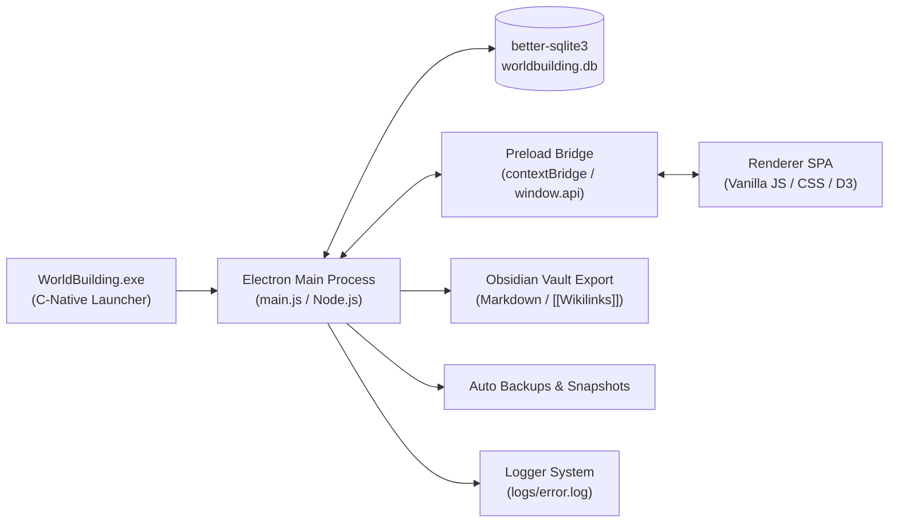
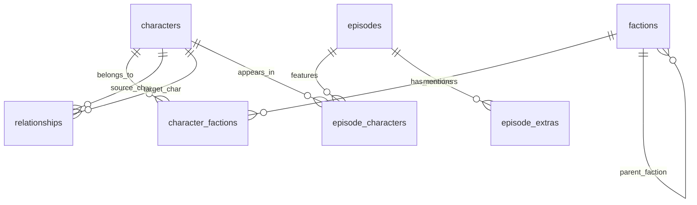
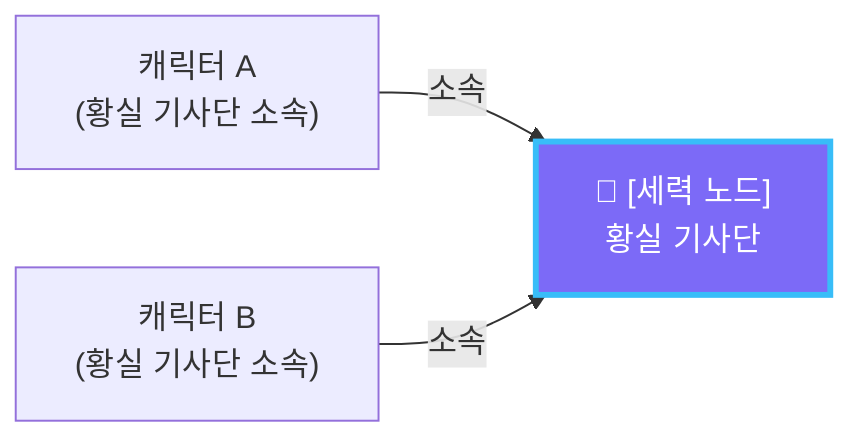

# 🪐 WorldBuilding App (세계관 빌더) 종합 기능 & 시스템 총괄 명세서 (Master Specification)

> **문서 목적**: 본 문서는 다른 AI 채팅 세션이나 새로운 개발자/협업자에게 **WorldBuilding App의 전체 아키텍처, 데이터베이스 스키마, 구현 원리, UI/UX 인터랙션 및 모든 세부 기능**을 한 번에 완벽하게 인계하고 설명하기 위해 작성된 공식 마스터 명세서입니다.

---

## 📑 목차
1. [프로젝트 개요 & 핵심 철학](#1-프로젝트-개요--핵심-철학)
2. [시스템 아키텍처 & 기술 스택](#2-시스템-아키텍처--기술-스택)
3. [전체 프로젝트 디렉터리 구조](#3-전체-프로젝트-디렉터리-구조)
4. [데이터베이스 스키마 & 데이터 모델 (SQLite)](#4-데이터베이스-스키마--데이터-모델-sqlite)
5. [창 제어, 네이티브 런처 & 로깅 시스템](#5-창-제어-네이티브-런처--로깅-시스템)
6. [모듈 1: 캐릭터 관리 (Characters)](#6-모듈-1-캐릭터-관리-characters)
7. [모듈 2: 세력 관리 (Factions)](#7-모듈-2-세력-관리-factions)
8. [모듈 3: 인물 관계 & 서사 (Relations)](#8-모듈-3-인물-관계--서사-relations)
9. [모듈 4: 인터랙티브 관계 그래프 (Graph)](#9-모듈-4-인터랙티브-관계-그래프-graph)
10. [모듈 5: 에피소드 관리 (Episodes)](#10-모듈-5-에피소드-관리-episodes)
11. [모듈 6: 생일 달력 (Calendar)](#11-모듈-6-생일-달력-calendar)
12. [모듈 7: 백업 & 옵시디언(Obsidian) 연동](#12-모듈-7-백업--옵시디언obsidian-연동)
13. [IPC 통신 인터페이스 규격 (API Reference)](#13-ipc-통신-인터페이스-규격-api-reference)

---

## 1. 프로젝트 개요 & 핵심 철학

* **프로젝트명**: WorldBuilding App (세계관 빌더)
* **목적**: 웹소설, 웹툰, 판타지/SF 소설, 게임 시나리오, TRPG 창작자를 위한 **완전 독립형 데스크톱 세계관·인물 서사 관리 플랫폼**.
* **핵심 철학**:
  1. **완전한 로컬 & 오프라인 독립성**: 클라우드 종속이나 외부 네트워크 통신 없이 사용자 로컬 PC의 임베디드 SQLite DB에 모든 설정을 안전하게 영구 저장합니다.
  2. **극도의 용량 최적화 (절대 경로 참조 방식)**: 고화질 캐릭터 일러스트나 설정화를 수백 장 등록해도 원본 파일을 복사하지 않고 파일 시스템 경로만 참조하므로 DB 용량 부담이 전혀 없습니다 (수 MB 미만 유지).
  3. **시각화와 서사의 공존**: D3.js 기반 물리 엔진을 통한 관계망 시각화와, 2,000자 이상의 장문 AI 서사 본문을 쾌적하게 집필·열람할 수 있는 마크다운 뷰어를 동시에 제공합니다.
  4. **옵시디언(Obsidian) 네이티브 생태계 연동**: 생성된 모든 데이터는 클릭 한 번으로 옵시디언 볼트(마크다운 + `[[위키링크]]` + YAML Frontmatter)로 무손실 내보내기가 가능합니다.



---

## 2. 시스템 아키텍처 & 기술 스택

| 분류 | 기술 / 라이브러리 | 버전 / 상세 | 역할 및 특징 |
| :--- | :--- | :--- | :--- |
| **Runtime** | **Electron** | `^28.0.0` | 크로스 플랫폼 데스크톱 런타임 (Chromium 120 + Node.js 18) |
| **Database** | **better-sqlite3** | `^9.4.3` | 고성능 동기식 로컬 SQLite3 엔진 (WAL 저널 모드 적용) |
| **Launcher** | **MinGW GCC / Win32 C** | `-mwindows` | 검은 콘솔창이 0.1초도 뜨지 않는 네이티브 무창 실행기 (`WorldBuilding.exe`) |
| **Graph Engine** | **D3.js** | `^7.9.0` | `d3-force` 물리 시뮬레이션 알고리즘 |
| **Canvas** | **HTML5 Canvas 2D** | Native | 300+개 이상의 노드와 곡선 엣지를 60fps로 렌더링하는 하이브리드 엔진 |
| **Markdown** | **Marked.js** | CDN / Local fallback | 인물 프로필, 관계 서사, 에피소드 본문 마크다운 파서 |
| **Typography** | **Pretendard** | `v1.3.9` | 가독성이 극대화된 프리미엄 시스템 웹폰트 전면 적용 |
| **Design System** | **Custom CSS** | CSS3 Variables | 다크/라이트 테마 자동 전환, 글래스모피즘, 반응형 레이아웃 |

---

## 3. 전체 프로젝트 디렉터리 구조

```text
X:\WorldBuilding\
├── WorldBuilding.exe        # [신규] MinGW C로 컴파일된 무창 네이티브 실행 파일
├── WorldBuilding.vbs        # 보조 VBScript 무창 런처
├── start.bat                # 배치 실행 파일 (무창 런처 실행 후 즉시 exit)
├── icon.ico / icon.png      # [신규] 코어 궤도(Core Orbit) 확정 앱 아이콘 (멀티 해상도)
├── launcher.c               # 런처 C 소스 코드 (WinMain, CreateProcess, 오류 수집)
├── app.rc                   # Windows 리소스 스크립트 (아이콘 번들링)
├── apply_selected_icon.py   # 아이콘 교체 및 리컴파일 유틸 스크립트
├── main.js                  # Electron 메인 프로세스 (Frameless 윈도우, IPC 통신 버스)
├── preload.js               # 안전한 contextBridge 샌드박스 API 노출
├── logger.js                # [신규] 메인/렌더러 통합 오류 및 일자별 로그 수집기
├── backup-manager.js        # 자동 스냅샷 롤링(15개), 수동 백업/복원, JSON 임포트/익스포트
├── obsidian-exporter.js     # 옵시디언 마크다운 볼트 변환 및 파일 생성기
├── package.json             # 의존성 및 메타데이터 정의
├── README.md                # 깃허브 공개 설명서
├── .gitignore               # node_modules, logs/, *.db, *.lnk 제외 규칙
├── logs/                    # [신규] 자동 생성되는 런타임 로그 폴더 (git 추적 제외)
│   ├── app_YYYY-MM-DD.log   # 일자별 전체 실행 흐름 로그
│   └── error.log            # 치명적 오류만 모아두는 긴급 로그
├── db/
│   └── database.js          # SQLite DDL/DML, 마이그레이션 및 비즈니스 쿼리 집약 모듈
└── renderer/                # 프론트엔드 UI (Vanilla SPA)
    ├── index.html           # 메인 HTML (커스텀 타이틀바, 페이지 섹션, 모달들)
    ├── icon.ico / icon.png  # 웹 파비콘 및 사이드바 로고 이미지
    ├── css/
    │   └── style.css        # 3,800+ 라인의 정교한 디자인 시스템 및 컴포넌트 스타일
    └── js/
        ├── app.js           # 라우팅, 전역 상태, 커스텀 타이틀바 제어, 글로벌 에러 캡처
        ├── characters.js    # 캐릭터 CRUD, 프로필 커스텀, 아바타 크롭, 키 비교, 카드 PNG
        ├── factions.js      # 세력 관리, 계층 트리, 소속 인물 필터링
        ├── relations.js     # 양방향/단방향 관계, 8대 팔레트, AI 장문 서사 리더
        ├── graph.js         # D3 Force + Canvas, 1/2촌 집중 모드, 세력 연계 최단 경로 탐색기
        ├── episodes.js      # 회차/사건 타임라인, 4단계 인물 분류, 프로필 즉시보기, 옴니버스
        ├── calendar.js      # 생일 달력 및 기념일 계산
        └── backup.js        # 백업/복원 및 옵시디언 내보내기 모달 UI 인터랙션
```

---

## 4. 데이터베이스 스키마 & 데이터 모델 (SQLite)

모든 데이터는 `%APPDATA%/worldbuilding/worldbuilding.db`에 저장됩니다.



### 테이블 상세 정의

#### 1. `characters` (캐릭터 테이블)
* `id` (INTEGER, PK, AUTOINCREMENT)
* `name` (TEXT, NOT NULL): 캐릭터 본명
* `aliases` (TEXT DEFAULT '[]'): 별명/이명 JSON 배열
* `age` (INTEGER), `birthdate` (TEXT), `gender` (TEXT), `origin` (TEXT): 기본 프로필
* `height` (INTEGER): 신장 (신장 비교 차트 연동)
* `status` (TEXT DEFAULT 'alive'): 생사 상태 (`alive`, `dead`, `missing`, `custom`)
* `status_custom` (TEXT DEFAULT ''): 사용자 정의 상태 명칭 (파란색 원형 배지로 정규 렌더링)
* `profile_public` (TEXT): **메인 프로필** (외모, 성격, 기본 설정 마크다운)
* `extra_profiles` (TEXT DEFAULT '[]'): **[신규] 추가 프로필 탭 JSON 배열**  
  구조: `[{"id": "...", "title": "비밀 프로필", "content": "..."}]`
* `custom_sections` (TEXT DEFAULT '[]'): **[신규] 그 외 정보 자유 커스텀 블록 JSON 배열**  
  구조: `[{"id": "...", "title": "과거사", "content": "..."}]`
* `prompt` (TEXT): AI 그림 생성용 프롬프트 (NovelAI, SD, Midjourney 등)
* `avatar_path` (TEXT): PC 로컬 이미지 원본 절대 경로
* `avatar_crop` (TEXT): 아바타 원형/사각 크롭 결과 썸네일 (Base64 DataURL, 수십 KB)
* `images` (TEXT DEFAULT '[]'): 캐릭터 갤러리 이미지 경로 목록 JSON 배열
* `color_palette` (TEXT DEFAULT '[]'): 테마 컬러 팔레트 JSON
* `created_at`, `updated_at` (TEXT)

#### 2. `factions` (세력 테이블)
* `id` (INTEGER, PK, AUTOINCREMENT)
* `name` (TEXT, NOT NULL): 세력/조직 명칭
* `description` (TEXT): 세력 개요 및 역사
* `color` (TEXT DEFAULT '#888888'): 세력 고유 Hex 컬러 (그래프 및 배지 연동)
* `parent_id` (INTEGER REFERENCES factions(id)): 상위 세력 (계층적 트리 구조)

#### 3. `character_factions` (세력 배속 다대다 매핑)
* `character_id` (INTEGER REFERENCES characters(id) ON DELETE CASCADE)
* `faction_id` (INTEGER REFERENCES factions(id) ON DELETE CASCADE)
* `role` (TEXT): 세력 내 직책/역할 (예: *단장, 연구원, 용병*)

#### 4. `relationships` (인물 관계 테이블)
* `id` (INTEGER, PK, AUTOINCREMENT)
* `char_a_id` (INTEGER REFERENCES characters(id) ON DELETE CASCADE)
* `char_b_id` (INTEGER REFERENCES characters(id) ON DELETE CASCADE)
* `is_mutual` (INTEGER DEFAULT 1): 1이면 양방향(⟷), 0이면 단방향(➔)
* `type` (TEXT): A ➔ B 관계 명칭 (예: *동료, 적대, 짝사랑*)
* `color` (TEXT): A ➔ B 관계 색상 Hex
* `type_b_to_a` (TEXT DEFAULT ''): B ➔ A 관계 명칭 (단방향일 때 B의 시선)
* `color_b_to_a` (TEXT DEFAULT ''): B ➔ A 관계 색상 Hex
* `description` (TEXT): 한 줄 관계 요약
* `narrative` (TEXT DEFAULT ''): **AI 장문 관계 서사 본문 (2,000자 이상 마크다운 지원)**

#### 5. `episodes` (에피소드/사건 테이블)
* `id` (INTEGER, PK, AUTOINCREMENT)
* `title` (TEXT, NOT NULL): 회차 제목 / 사건명
* `summary` (TEXT DEFAULT ''): 줄거리 요약 및 사건 상세 기록

#### 6. `episode_characters` (에피소드 인물 출연 매핑)
* `episode_id` (INTEGER REFERENCES episodes(id) ON DELETE CASCADE)
* `character_id` (INTEGER REFERENCES characters(id) ON DELETE CASCADE)
* `role_type` (TEXT DEFAULT 'main'): **4단계 역할 구분**
  - `'main'`: 주연 (핵심 활약)
  - `'sub'`: 조연 (보조 출연)
  - `'mentioned'`: **[신규] 이름으로만 언급된 캐릭터** (등장 통계 미집계)

#### 7. `episode_extras` (에피소드 일회성 엑스트라)
* `id` (INTEGER, PK, AUTOINCREMENT)
* `episode_id` (INTEGER REFERENCES episodes(id) ON DELETE CASCADE)
* `name` (TEXT NOT NULL): 단역 이름
* `description` (TEXT): 엑스트라 설명

---

## 5. 창 제어, 네이티브 런처 & 로깅 시스템

### 1. 무창 네이티브 런처 (`WorldBuilding.exe`)
* **문제 해결**: 과거 `start.bat` 실행 시 나타나던 검은색 cmd 콘솔 창을 완전히 없앴습니다.
* **구현 방식**: MinGW GCC를 통해 `-mwindows` (Win32 GUI Subsystem) 플래그로 컴파일되어 창 없는 네이티브 바이너리로 빌드되었습니다.
* **프로세스 맵**:
  1. `WorldBuilding.exe` 실행 ➔ 현재 경로 탐색
  2. `node_modules\electron\dist\electron.exe .`를 백그라운드 프로세스로 호출
  3. 런처 자신은 메모리를 점유하지 않고 즉시 정상 종료(`return 0`)
  4. 실패 시 `logs/launch_error.log`에 에러를 기록하고 안내 메시지 박스 출력

### 2. 프레임리스(Frameless) 커스텀 타이틀바
* `main.js`의 `BrowserWindow` 옵션에 `frame: false` 적용.
* 투박한 Windows 기본 제목 표시줄 및 시스템 기본 폰트(굴림/맑은고딕) 타이틀/아이콘을 전면 제거.
* **인터랙션**:
  - 상단 빈 영역 드래그 시 창 이동 (`-webkit-app-region: drag`)
  - 빈 영역 **더블 클릭 시 창 최대화 / 이전 크기 복원 토글**
  - 컨트롤 버튼 세트 (`-webkit-app-region: no-drag`):
    - `─` 최소화 (`btn-win-minimize`)
    - `□` / `❐` 최대화 / 복원 (`btn-win-maximize`): 창 상태에 따라 SVG 아이콘 동적 전환
    - `✕` 닫기 (`btn-win-close`): 마우스 호버 시 윈도우 감성의 강렬한 레드(`--danger`, `#e81123`) 하이라이트

### 3. 양방향 오류 로그 수집 파이프라인 (`logger.js`)
* 자동 생성 디렉터리: `X:\WorldBuilding\logs\`
* **로그 파일 이원화**:
  - `logs/app_YYYY-MM-DD.log`: 날짜별 구동 흐름 및 INFO/WARN/ERROR 전체 기록
  - `logs/error.log`: 치명적 에러(ERROR / FATAL)만 따로 모아 빠른 트러블슈팅 지원
* **메인 프로세스**: Node.js의 `uncaughtException`, `unhandledRejection` 자동 캡처
* **렌더러 프로세스**: 웹 화면의 `window.onerror`, `window.onunhandledrejection`을 IPC(`log:error`)로 메인 로거에 실시간 전달하여 스택 트레이스 완벽 보존

---

## 6. 모듈 1: 캐릭터 관리 (Characters)

### 1. 프로필 커스터마이징 아키텍처
* **메인 프로필**: 캐릭터마다 기본 제공되는 프로필 블록 (마크다운 포맷 지원).
* **추가 프로필 (+추가 버튼)**:
  - 비밀 프로필, 과거 프로필, IF 외전 프로필 등을 사용자가 원하는 만큼 무제한 생성.
  - 프로필 블록마다 **명칭(Title)을 자유롭게 변경** 가능.
  - 각 프로필마다 **독립된 `[📋 복사]` 버튼**이 장착되어 해당 탭 내용만 원클릭 복사.
* **그 외 정보 (자유 서사 블록)**:
  - 옵시디언이나 설정집에서 복사해 온 '과거사', '인물관계', '전투능력', '특이사항' 등을 모듈형 블록으로 추가.
  - 각 항목별 독립 `[📋 복사]` 버튼 및 제목 편집 지원.

### 2. 시각화 & 갤러리
* **아바타 크롭**: 업로드한 일러스트에서 정사각형/원형 대표 얼굴 영역을 캔버스로 크롭하여 최적화된 썸네일 생성.
* **라이트박스 뷰어**: 갤러리 등록 이미지를 고화질로 열람하며 좌우 방향키로 연속 탐색 가능.
* **신장(키) 비교 차트**: 등록된 인물들의 키(`height`)를 오름차순으로 정렬하여 대표 아바타와 함께 실제 서 있는 비율 차트로 렌더링 (`[📏 키 비교]` 버튼).
* **프로필 카드 PNG 내보내기**: 대표 이미지, 세력 배지, 기본 스펙, 공개 프로필 요약이 담긴 미려한 인포그래픽 카드를 PNG 이미지 파일로 저장하거나 클립보드로 복사.

---

## 7. 모듈 2: 세력 관리 (Factions)

* **조직 계층화**: 상위 세력(`parent_id`) 지정을 통해 제국 ➔ 황실 기사단 ➔ 제1분대와 같은 트리형 계층 구조 표현.
* **테마 컬러링**: 세력마다 고유 Hex 컬러를 지정하여 인물 카드 배지, 관계 그래프 노드 링, 세력 노드 방패 배지에 일관되게 적용.
* **세력 필터**: 특정 세력 클릭 시 소속된 캐릭터 카드들만 즉시 필터링 열람.

---

## 8. 모듈 3: 인물 관계 & 서사 (Relations)

### 1. 양방향 vs 단방향(시선 분리) 관계
* **양방향 (⟷)**: 두 인물이 동등하게 인정하는 상호 관계 (동료, 연인, 부모자식, 라이벌 등).
* **단방향 (➔)**:
  - $A \to B$ 관계와 $B \to A$ 관계를 완전히 독립 지정 (예: A는 짝사랑, B는 무관심).
  - **상대방을 모르는 상태 지원**: 한쪽이 `(지정 안 함 / 모름)`일 경우 불필요한 역방향 선 없이 **단일 화살표**만 생성.

### 2. 8대 기준 색상 팔레트 & 커스텀 입력
* 기본 8대 유형: `적대(#f43f5e)`, `우호(#10b981)`, `가족(#f59e0b)`, `연인(#ec4899)`, `동료(#3b82f6)`, `라이벌(#8b5cf6)`, `스승/제자(#06b6d4)`, `기타(#64748b)`
* 사용자가 자유롭게 관계명을 타이핑하여 직접 입력할 수 있으며, 8대 기준 색상 중 하나를 매핑하여 시각적 통일성을 유지.

### 3. AI 장문 관계 서사 리더 (Narrative Viewer)
* 두 인물 사이의 역사와 심리를 다룬 2,000자 이상의 장문 텍스트를 마크다운 서식으로 열람.
* 상단에 *"해당 관계는 세계관 시작 시점의 관계입니다"* 안내 문구가 명시되어 에피소드 진행에 따른 동적 변화와 설정 충돌 방지.
* 우측 상단 버튼을 통해 해당 인물 간의 관계 그래프 집중 모드로 원클릭 점프.

---

## 9. 모듈 4: 인터랙티브 관계 그래프 (Graph)

### 1. 고성능 렌더링 엔진
* **D3 Force + HTML5 Canvas**: 물리 시뮬레이션 계산은 D3가 담당하고 화면 그리기는 순수 Canvas 2D로 처리하여 대규모 노드 환경에서도 렉 없이 동작.
* **2중 베지에 곡선(Bezier Curve) 분리**: 서로 다른 단방향 관계($A \to B$, $B \to A$)가 겹쳐서 글자가 깨지는 문제를 해결하기 위해 반대편으로 호를 그리며 화살표와 알약 배지가 분리 렌더링됨.

### 2. 🎯 특정 인물 중심 집중 모드 (Ego Network)
* 그래프 상의 노드를 더블 클릭하거나 인물 선택 시 발동.
* **1촌 집중**: 해당 인물과 직접 관계를 맺은 사람들만 남기고 나머지 페이드아웃.
* **2촌 집중**: 지인의 지인까지 2단계 관계망 확장 표시.

### 3. 🔍 소속 세력 연계 최단 경로 탐색기 (Pathfinder)



* **동작 원리**:
  - 직접적인 인물 관계(`relationships`)가 없더라도, **동일한 세력에 소속되어 있다면 해당 세력을 매개 고리(관계)로 취급**하여 최단 경로를 산출.
  - 옵션: `[✔] 🏰 소속 세력 연계 포함` 토글 지원.
* **세력 노드(Faction Node) 동적 생성**:
  - 임의로 두 인물을 가짜 선으로 건너뛰는 방식이 아니라, 경로 상에 **실제 세력 노드(`🏰 세력명`)가 하나의 독립된 단계**로 삽입.
  - 모달 체인 표시: `[캐릭터 A] ➔ [🏰 소속] ➔ [🏰 세력 노드] ➔ [🏰 소속] ➔ [캐릭터 B]`
* **캔버스 하이라이트 동적 주입**:
  - 하이라이트 실행 시 그래프 상에 **세력 노드(방패/배지 심볼, 세력 고유 컬러)**가 실제로 추가 배치됨.
  - 최단 경로 상의 캐릭터들은 물론, **현재 화면에 존재하는 해당 세력의 다른 모든 소속 캐릭터들도 세력 노드와 연결선(`소속`)으로 결합**되어 세력 중심 허브-스포크 네트워크가 시각화됨.
  - 하이라이트 해제 시 임시 주입된 노드와 간선이 깨끗이 정리되어 원상 복구.

---

## 10. 모듈 5: 에피소드 관리 (Episodes)

### 1. 등장인물 4단계 분류 시스템
1. **주연 (Main)**: 사건의 중심축을 이끄는 캐릭터 (출연 통계 가중치)
2. **조연 (Sub)**: 사건에 직접 참여하고 비중이 있는 캐릭터
3. **엑스트라 (Extra)**: 지나가는 행인, 경비병 등 일회성 단역 (인물 목록을 어지럽히지 않고 에피소드 내에서 즉석 추가)
4. **이름으로만 언급되는 캐릭터 (Mentioned)**:
   - 서사에 직접 모습을 드러내지 않고 대사나 회상으로만 언급된 기존 캐릭터 정리.
   - **등장 통계에는 취급되지 않아(출연 0회 유지) 데이터 왜곡 방지**.

### 2. 에피소드 내 인물 프로필 즉시 보기
* 에피소드 상세 화면에서 주요 등장인물을 클릭하면 화면을 벗어나지 않고 **해당 캐릭터의 상세 프로필 모달이 즉시 팝업**.
* 상단 **`[뒤로가기]`** 버튼을 통해 원래 읽던 에피소드 상세 화면으로 완벽하게 복귀.

### 3. 출연 통계 & 🎲 옴니버스 소재 랜덤 조합기
* 각 캐릭터 카운터에 주연/조연 출연 횟수가 누적 집계되며, 한 번도 등장하지 않은 인물만 모아보는 **'미등장 인물 필터'** 지원.
* **[🎲 옴니버스 조합기]**: "출연이 뜸한 비운의 인물"과 "자주 등장한 주연 인물"을 랜덤으로 매칭하여 새로운 사이드 스토리 및 에피소드 키워드를 제안.

---

## 11. 모듈 6: 생일 달력 (Calendar)

* 월별(1월~12월) 캘린더 인터페이스를 통해 캐릭터들의 생일과 기념일을 한눈에 확인.
* 특정 날짜 클릭 시 해당 일자에 태어난 인물들의 아바타와 나이 정보 노출.

---

## 12. 모듈 7: 백업 & 옵시디언(Obsidian) 연동

### 1. 옵시디언(Obsidian) 마크다운 볼트 변환기
* **[📁 폴더 선택]** ➔ **[🚀 옵시디언 볼트로 전체 내보내기]** 원클릭 실행.
* **생성 폴더 구조**:
  - `Characters/`: 캐릭터별 `.md` (YAML Frontmatter 메타데이터, 외모/성격/배경, 접기형 비밀 프로필, 인물 관계 위키링크, 출연 에피소드)
  - `Relationships/`: `[인물A] - [인물B].md` 형태의 2,000자 장문 관계 서사 문서
  - `Episodes/`: 사건 요약 및 `[[인물 위키링크]]`가 포함된 회차별 문서
  - `Factions/`: 세력 설명 및 소속 인물 링크 문서
  - `_WorldBuilding_Home.md`: 볼트 전체 대시보드 인덱스 문서
* **옵시디언 자체 그래프 뷰(Graph View) 연동**: 모든 인물과 사건이 `[[위키링크]]`로 연결되어 옵시디언 내에서도 유기적인 관계망 그래프가 그대로 펼쳐집니다.

### 2. 3중 데이터 안전망
1. **앱 시작 시 자동 스냅샷 (Startup Snapshot)**:
   - 앱이 켜질 때마다 `%APPDATA%/worldbuilding/backups/`에 날짜·시각이 명시된 DB 스냅샷을 자동 생성 (최근 15개 파일 자동 롤링 보관).
2. **수동 DB 백업 & 복원**:
   - 사용자가 원하는 외장하드, 클라우드 폴더 등에 단일 `.db` 파일로 수동 백업 및 과거 시점으로 즉시 롤백 복원.
3. **표준 JSON 익스포트 & 임포트**:
   - SQLite 바이너리가 아닌 표준 JSON 텍스트 포맷(`worldbuilding_export.json`)으로 전체 데이터를 추출하거나 가져오기 지원.

---

## 13. IPC 통신 인터페이스 규격 (API Reference)

`preload.js`를 통해 `window.api` 객체로 노출되는 IPC API 규격입니다.

```typescript
interface WindowAPI {
  // Characters
  getCharacters(): Promise<Character[]>;
  getCharacter(id: number): Promise<Character>;
  createCharacter(data: Partial<Character>): Promise<{ id: number }>;
  updateCharacter(id: number, data: Partial<Character>): Promise<void>;
  deleteCharacter(id: number): Promise<void>;

  // Factions
  getFactions(): Promise<Faction[]>;
  createFaction(data: Partial<Faction>): Promise<{ id: number }>;
  updateFaction(id: number, data: Partial<Faction>): Promise<void>;
  deleteFaction(id: number): Promise<void>;

  // Relationships
  getRelationships(): Promise<Relationship[]>;
  getRelationshipBetween(aId: number, bId: number): Promise<Relationship | null>;
  createRelationship(data: Partial<Relationship>): Promise<{ id: number }>;
  updateRelationship(id: number, data: Partial<Relationship>): Promise<void>;
  deleteRelationship(id: number): Promise<void>;

  // Graph
  getGraphData(): Promise<{ nodes: GraphNode[]; edges: GraphEdge[] }>;

  // Episodes
  getEpisodes(): Promise<Episode[]>;
  getEpisode(id: number): Promise<EpisodeDetail>;
  getSharedEpisodes(aId: number, bId: number): Promise<Episode[]>;
  createEpisode(data: any): Promise<{ id: number }>;
  updateEpisode(id: number, data: any): Promise<void>;
  deleteEpisode(id: number): Promise<void>;

  // Window Controls (Frameless Titlebar)
  minimizeWindow(): void;
  maximizeWindow(): void;
  closeWindow(): void;
  isWindowMaximized(): Promise<boolean>;
  onWindowStateChange(callback: (data: { isMaximized: boolean }) => void): void;

  // Logging
  logError(source: string, message: string, err?: any): void;
  logInfo(source: string, message: string): void;

  // Dialog & File
  openImage(): Promise<string | null>;
  openImages(): Promise<string[]>;
  selectDirectory(): Promise<string | null>;
  saveBackupFile(): Promise<string | null>;
  openBackupFile(): Promise<string | null>;
  saveJsonFile(): Promise<string | null>;
  openJsonFile(): Promise<string | null>;
  saveImageDataUrl(options: { dataUrl: string; defaultName: string }): Promise<boolean>;

  // Clipboard
  copyImage(path: string): Promise<boolean>;
  copyImageDataUrl(dataUrl: string): Promise<boolean>;
  copyText(text: string): Promise<boolean>;

  // Backup & Obsidian
  getDbInfo(): Promise<{ sizeBytes: number; path: string; charCount: number; relCount: number }>;
  createSnapshot(): Promise<{ success: boolean; filename: string }>;
  listSnapshots(): Promise<string[]>;
  backupToFile(targetPath: string): Promise<{ success: boolean }>;
  restoreFromPath(backupPath: string): Promise<{ success: boolean }>;
  exportJSON(targetPath: string): Promise<{ success: boolean }>;
  importJSON(jsonPath: string): Promise<{ success: boolean; count: number }>;
  exportObsidianVault(targetDir: string): Promise<{ success: boolean; count: number; dir: string }>;
}
```

---

> [!TIP]
> **다른 세션/에이전트에 전달할 때 팁**:  
> 본 마스터 명세서([`WORLDBUILDING_FULL_FEATURE_SPEC.md`](file:///X:/WorldBuilding/WORLDBUILDING_FULL_FEATURE_SPEC.md)) 전문을 다른 세션에 전달하면, 세션이 끊기거나 새로운 대화방에서도 프로젝트의 데이터 구조와 비즈니스 로직, UI 컴포넌트 간의 상호작용을 100% 온전하게 이해하고 즉시 작업을 이어갈 수 있습니다.
